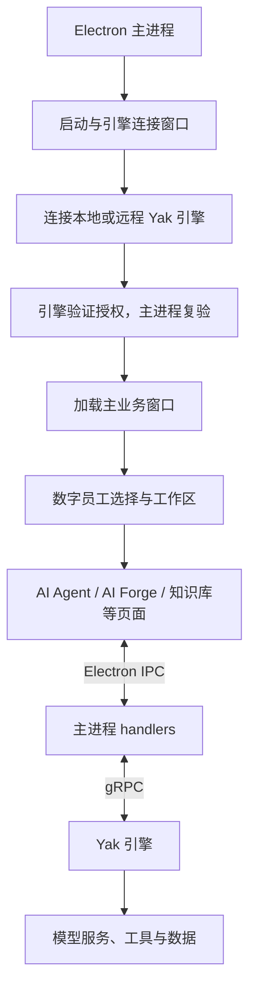

# AI Senso 项目导览：与 Memfit / Yakit 的关系

核对日期：2026-10-30。代码基准：本地 `main`，`afc69b034`（2026-10-13）。

当前交接入口：[HANDOFF.md](HANDOFF.md)。官方功能迁入方式和来源台账见 [UPSTREAM_SYNC.md](UPSTREAM_SYNC.md)。

本文依据当前源码、构建配置、Git 历史和仓库交接文档整理；未连接实际引擎、授权服务或 GitHub Actions，也未执行运行验收。历史文档中的“已验证”不代表本次重新验证。

## 1. 项目定位

当前项目是在 Yakit 多产品客户端框架中，沿用 `memfit` 产品模式继续定制的 AI Senso 桌面应用。代码仍同时保留 Yakit、企业版、IRify 等模式，因此项目目录里存在大量并非 AI Senso 默认菜单入口的功能。

**用户确认的长期策略：引擎保持官方最新、不维护定制引擎；客户端一条线保留 AI Senso 名称、Logo、数字员工页面等定制，另一条线对照官方最新 Memfit 前端，直接迁入核心实现并接回定制。** 这里的客户端包含 Electron、IPC、协议定义和打包适配。本文描述代码现状，不表示当前工作区已与官方最新同步。

可以按三个层次理解：

- **Yakit / Yaklang 基础框架**：Electron 桌面壳、窗口和引擎管理、IPC / gRPC 通信、通用组件，以及安全工具页面。
- **Memfit 产品路径**：以 AI Agent、AI Forge、知识库、记忆库、工具库为中心的界面与菜单，通过 `memfit` 构建配置选择。
- **AI Senso 定制**：数字员工角色入口和工作区、角色与智能体归属、品牌、启动授权和构建交付适配；AI 会话与任务核心功能按策略对照官方迁入，再接回数字员工适配。

这是当前代码的组织关系，不是已经核实的上游完整版本演进记录。

当前仓库主要包含桌面客户端和 protobuf 协议。未发现 Yak 引擎的 Go 源码或 `go.mod`；真正的任务执行、工具运行、引擎侧数据存储与授权验证依赖另行提供的 Yak 引擎。

新增功能优先同步官方前端并使用官方已有接口；不将修改引擎作为本项目默认实施方案。

## 2. 运行架构



主进程管理窗口、引擎连接、系统能力和 RPC 转发；React 负责界面、输入、会话状态与流式事件展示；引擎负责实际执行。客户端不是把所有业务都直接作为 HTTP 请求发送到一个 Web 后台。

AI Senso 的核心启动顺序可在以下位置核对：

1. `app/main/index.js`：创建启动窗口；Memfit 完成连接时复验缓存授权，再加载主渲染器。
2. `app/renderer/engine-link-startup/src/pages/StartupPage/components/MemfitLicenseGate/index.tsx`：启动窗口授权界面。
3. `app/main/memfitLicense.js`：通过引擎 `GetLicense`、`CheckLicense`、`GetKey`、`SetKey` 申请、验证和缓存授权。
4. `app/renderer/src/main/src/components/layout/UILayout.tsx`：主界面授权状态、数字员工 Provider 与 Gate。

## 3. 目录地图

| 位置 | 职责 | 修改场景 |
| --- | --- | --- |
| `app/main/index.js` | Electron 入口、窗口生命周期、启动授权顺序 | 启动流程、窗口行为 |
| `app/main/preload.js`、`engineLinkPreload.js` | 渲染器与主进程之间的桥接 | 增加或限制桌面能力 |
| `app/main/ipc.js`、`handlers/` | 创建引擎客户端、注册 IPC、转发 gRPC 与流式事件 | 前后端接口联调 |
| `app/protos/grpc.proto` | Yak 引擎客户端接口协议 | 同步官方 RPC 和字段，匹配官方引擎 |
| `app/renderer/engine-link-startup/` | React + TypeScript + Vite 启动连接页 | 引擎连接、启动授权页 |
| `app/renderer/src/main/` | React 18 + TypeScript + CRA / react-app-rewired 主应用 | 主要业务界面 |
| `.../src/pages/digitalEmployee/` | 数字员工选择、角色映射、欢迎页与工作区 | AI Senso 特有业务 |
| `.../src/pages/ai-agent/` | AI 主页面、输入组件、任务展示、历史与定时任务页面 | AI 交互体验 |
| `.../src/pages/ai-re-act/` | 会话控制、发送、流事件处理、状态与内容持久化组织 | 消息与多会话问题 |
| `.../src/pages/aiForge/` | 智能体广场及编辑 | 智能体管理、角色分配 |
| `.../src/routes/newRoute.tsx` | 各产品的路由和菜单 | 改变可见功能入口 |
| `packageScript/` | 产品身份、Electron Builder、安装包配置 | 改名、图标、安装包 |
| `scripts/`、`.github/workflows/` | 字节码构建、原生平台打包、产物验证、发布 | CI 与交付 |
| `docs/` | 交接和变更记录 | 查需求背景；结论需与当前源码复核 |

表格中 `.../src/` 指 `app/renderer/src/main/src/`。

## 4. 数字员工、智能体和工具分别是什么

### 4.1 数字员工是固定业务角色

`pages/digitalEmployee/config.ts` 定义八个角色：威胁分析专家、渗透测试专家、运营服务管家、数字猎手、数字情报官、首席信息安全官、数字教师、应急响应专家。

这里定义的是角色名称、介绍、头像、展示技能和主题色。修改展示技能文字不会自动增加引擎工具或执行能力。

### 4.2 AI Forge 是可执行智能体

一个数字员工角色可以关联多个 AI Forge。当前通过 `AIForge.Tag` 中的 `senso-role:<role-id>` 标记归属，例如 `senso-role:threat-analyst`。

- `roleAssignment.ts`：生成、解析内部角色标签，并从普通标签展示中隐藏它们。
- `DigitalEmployeeContext.tsx`：分页查询 Forge、按角色分组、维护当前角色与智能体。
- 未带有效角色标签的 Forge 被归入“未分配”，不会因为名称类似就自动归属。
- 当前角色默认选中按 ID 升序排列的第一个 Forge；刷新后保留仍有效的手动选择。
- 切换角色会重新选择该角色的默认 Forge；进入已有会话时可通过真实 `ForgeName` 恢复角色和智能体。

角色标签是分类协议，不是授权权益协议。

### 4.3 输入标签与执行请求共用原有链路

```text
选择角色 → 选择 AI Forge → 输入框默认 forge mention
        → ForgeName + AttachedResourceInfo
        → 会话控制器 → Electron IPC → StartAIReAct gRPC
        → 引擎事件返回 → 会话状态与界面更新
```

关键文件：`digitalEmployee/resolver.ts`、`ai-re-act/aiReActChat/AIReActChat.tsx`、`ai-re-act/hooks/useChatIPC.ts`、`ai-re-act/hooks/ChatMultiSessionController.ts`、`app/main/handlers/ai-agent.js`。

`resolver.ts` 将选中 Forge 写入启动参数，并为输入事件补齐资源引用、避免重复附加。界面中的角色包装没有替换原有 AI 执行引擎。

## 5. 客户端定制与官方功能同步

| 方向 | 当前可确认的内容 |
| --- | --- |
| 产品与品牌 | AI Senso 名称、Logo、主题、窗口和安装包身份；历史路径仍有 AI SenPike / Memfit 字样 |
| 数字员工 | 八角色选择页、侧栏、工作区、角色与 Forge 的一对多映射、默认智能体标签 |
| 功能组织 | Memfit 专用菜单，六个快捷入口复用原有路由；保留知识库、记忆库、工具库、插件与数据库页面 |
| 官方核心功能同步及接入 | 任务计划、任务与文件展示、多会话、历史、流内容和定时任务；按用户策略对照官方迁入并保留数字员工适配，历次来源 SHA 尚待补全 |
| 授权与桌面权限 | 启动页授权、主进程复验、专用桥接、文件访问限制、生产调试限制和安装包完整性配置 |
| 交付 | Electron 主进程字节码、运行资产校验、原生 Windows / Linux / macOS 构建和 Release 产物汇总 |

上述是当前本地历史中可见的改动方向。不能把所有文件变化都视为原创功能：其中还包含锁文件、第三方 vendored 文件及可能来自上游的改动，需要对应原始基线才能逐项判定来源。

特别注意：9 月的 `ac62cf39e` 涉及 361 个文件，已经覆盖较大范围的 AI 会话和任务架构；后续排查不能只阅读 8 月数字员工交接文件。

## 6. 多产品配置为什么容易混淆

AI Senso 的产品显示名已经变化，但仍使用 `memfit` 作为内部模式：

| 运行环节 | 当前配置 |
| --- | --- |
| 主渲染器 | `.env-cmdrc` 中 `REACT_APP_PLATFORM=memfit` |
| 启动连接页 | `.env.memfit` 中 `VITE_PLATFORM=memfit` |
| 开发态 Electron | 根 `yarn dev` 设置 `YAKIT_APP_PLATFORM=memfit` |
| 安装包构建 | `packageScript/.env-cmdrc` 中 `PLATFORM=memfit` |
| 产品身份 | `com.aisenso.desktop` / `AI Senso` |

不要通过全局替换 `memfit`、`yakit` 或旧品牌名称完成重命名：这些字符串有些用于产品分支、接口、持久化和兼容逻辑。例如当前授权请求仍使用 `CompanyVersion: EnpriTrace`，修改前需核对引擎协议。

## 7. 本地运行与打包

仓库有三个独立的 `package.json` 和 `yarn.lock`，分别位于根目录、主渲染器与启动连接页。

已有依赖时，从仓库根目录运行：

```powershell
yarn dev
```

当前脚本启动主渲染器 `3000`、连接页 `127.0.0.1:5713`，等待两者可连接后启动 Memfit 模式 Electron。根脚本使用 Windows `set` 语法。

Windows 本地打包命令为：

```powershell
yarn pack-win-memfit
```

该命令依次构建两套渲染器、编译主进程字节码并调用 Electron Builder。多平台交付使用 `.github/workflows/multi-platform-build.yml` 等工作流，具体见 `docs/github-desktop-packaging.md`。

CI 未指定引擎版本时在构建开始解析一次官方 latest，各平台共用该版本；这不等于已安装客户端自动升级。当前 Memfit 跳过部分引擎检查和更新入口，详见当前交接。

主渲染器开发构建基于 CRA，连接页基于 Vite，主进程生产构建另用 electron-vite；不能把整个项目当成单一 Vite 应用。

## 8. Git 来源和上游同步边界

本地 `HEAD` 可达 63 个提交，根提交为 `acaae6997`（2026-07-29），一次性导入 3104 个文件，且提交本身已经包含数字员工体验。

当前远端为 GitHub `why-2018/AISenso` 与备用 Gitee `a1543733438/ai-sense`，没有配置 yaklang 上游远端。

这意味着：

1. 可以追踪首次导入之后的改造，但无法只用现有提交历史完整分离“官方原版”和“首次导入已有的定制”。
2. 要准确回答“基于上游哪个 commit、累计改了哪些代码”，需找回当时的原始压缩包、上游 commit 或未定制副本。
3. 仓库旧文档记载过与上游无共同祖先的比对结果；本文没有重新获取上游验证，不能将旧结论当作最新比对。
4. 用户已明确采用官方前端对照迁入的方式：本轮取得确定来源、识别定制边界、迁入完整实现后恢复定制。无需把重建全仓历史作为每次同步的前提，也不默认进行全仓 merge / rebase。

## 9. 已知待确认事项与阅读顺序

以下来自现有实现或历史交接，均不表示本次已复现故障：

- **内置智能体归属初始化**：前端已读取与维护角色 Tag，但默认归属清单和历史数据仍需核实。`DEFAULT_AGENT_ASSIGNMENT_BACKEND.md` 是历史交付讨论；不据此要求维护定制引擎，优先使用官方现有 Forge 接口处理客户端归属。
- **授权商业规则**：启动授权已接入；项目签发、设备绑定、试用期限、维保和角色权益不能仅凭客户端授权页判断已完成，需要核对官方引擎与签发服务现有能力，不能自动转成定制引擎开发。
- **历史签发错误**：交接中记录过 RSA 解密失败，需核对签发端与引擎版本、协议和密钥；本次未连接服务确认是否仍存在。
- **桌面隔离状态**：启动窗口已使用 `nodeIntegration:false` 与 `contextIsolation:true`；主业务窗口仍为 `true/false`，并保留原始 IPC 兼容入口，不能描述为全应用均已完成隔离迁移。
- **交付状态**：仓库有完整构建与验证脚本，但本次没有查询远端流水线或实际安装验收，不能据此认定最新各平台包均通过。

历史交接存在已过期描述。例如 `DIGITAL_EMPLOYEE_HANDOFF.md` 提到的 `MEMFIT_LICENSE_REQUIRED` 开关在当前 `memfitLicense.js` 已不存在，当前以启动主进程实际校验为准。

建议先读本导览，再按目标进入：数字员工读 `config.ts` → `roleAssignment.ts` → `DigitalEmployeeContext.tsx`；聊天读 `AIReActChat.tsx` → `useChatIPC.ts` → `ChatMultiSessionController.ts` → `handlers/ai-agent.js`；授权读 `index.js` → `memfitLicense.js`；交付读 `github-desktop-packaging.md`。
